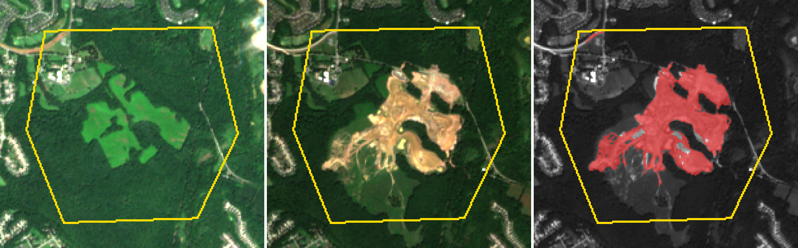

# Parcel change alerts (prototype)

Flags possible clearing or ground disturbance inside land parcels, such as
conservation easements, using free Sentinel-2 imagery. Give it parcel
boundaries; it compares this season with the same season a year earlier
and reports patches where vegetation was lost, with before and after
pictures.

Working name and demo parcels are placeholders. Nothing here has been shown
to a land trust or customer.



## Sample run

Summer 2023 against summer 2025 on four hand-drawn demo parcels in
Maryland and Pennsylvania ([full report](docs/sample/index.html),
[alerts.json](docs/sample/alerts.json)):

| Parcel | Expected | Result |
|---|---|---|
| A: wooded tract | Cleared for development 2024-25 | Flagged, 44 ha |
| B: mature forest | No change | No change |
| C: fields beside an industrial park | Grading on part of it | Flagged, 6 ha (earthworks along the road) |
| D: farmland with crop rotation | No change | No change |

The boundaries are drawn by hand around places picked from a scan of the
imagery. They are not real parcel or easement records.

## How it works

1. **Find scenes.** Lists the public `sentinel-cogs` bucket on AWS for the
   parcel's Sentinel-2 tile. No account, API key or STAC service needed.
2. **Mask clouds.** Reads only the parcel's window from each scene (red,
   near-infrared, scene classification) and drops cloud, shadow and snow
   pixels.
3. **Seasonal greenness.** For each pixel, takes the 90th percentile NDVI
   over all clear looks in the window. Forest is green all season, so a
   large drop means cover was removed. Crop fields that green up at any
   point in the window keep a high value, which keeps rotation from
   triggering flags.
4. **Flag patches.** A pixel is flagged when it was green before (NDVI 0.6
   or more) and its greenness fell by 0.3 or more. Patches under 0.25 ha
   are dropped. If less than half of the parcel had at least two clear
   looks in each window, the result is "not enough clear imagery" rather
   than "no change".
5. **Report.** `alerts.json`, a before/after/change picture per parcel, and
   an HTML page.

## Run it

```
pip install -r requirements.txt
python -m parcelwatch.run parcels/demo.geojson --out out \
    --baseline 2023-06-01:2023-09-15 --recent 2025-06-01:2025-09-15
open out/index.html
```

Without `--baseline` and `--recent` it compares the last 90 days with the
same 90 days a year earlier. Parcels are a GeoJSON FeatureCollection of
polygons in longitude/latitude with `id` and `name` properties. A run of
four parcels over two summers takes about three minutes.

Tests: `python -m pytest -q tests`

## Scheduled runs

`.github/workflows/check-parcels.yml` runs every Monday and on demand. It
puts a summary table on the run page and uploads the report as an
artifact. To have it open a GitHub issue when something is flagged, set
the repository variable `OPEN_ISSUES` to `true`.

## Limits

- 10 m pixels: small buildings, sheds, trails and selective cutting are
  usually missed. Each flag is a lead for a closer look, not a finding.
- Optical only. Long cloudy stretches show up as "not enough clear
  imagery". Sentinel-1 radar would fill those gaps and is the obvious next
  step.
- Drought, fire, storms, mowing and fallowed fields can cause flags.
- Comparing late autumn or winter windows is weaker because there is less
  green to lose.
- Parcels are matched to one Sentinel-2 tile by their centre. A parcel on a
  tile edge can set a `tile` property (for example `"tile": "18SUJ"`).

## Data credit

Contains modified Copernicus Sentinel data 2023 and 2025, read from the
Sentinel-2 Cloud-Optimized GeoTIFFs on the Registry of Open Data on AWS.
